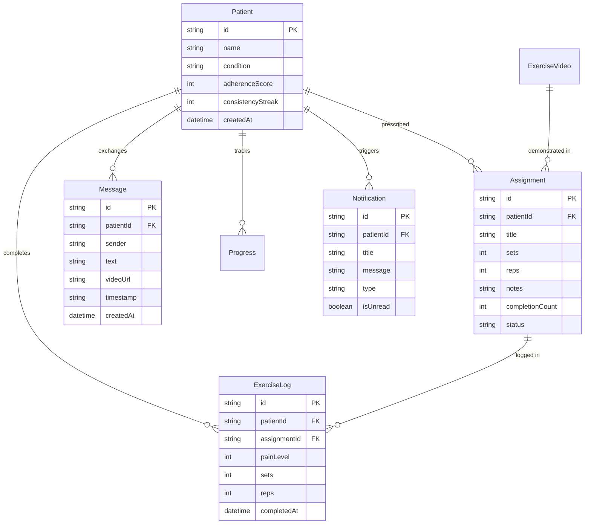

# VirtuHeal — Backend Architecture & Code Execution Guide (`backend.md`)

This guide explains the backend architecture used in VirtuHeal, detailing how the server works, how data is stored, and **exactly which backend code executes for every feature and user action on the website**.

---

## 1. High-Level Backend Overview

VirtuHeal is built on an enterprise-grade full-stack architecture with a dedicated Node.js/Express backend, relational SQLite database via Prisma ORM, and bi-directional WebSockets via Socket.IO.

```
┌────────────────────────────────────────────────────────┐
│                   FRONTEND (React + Vite)              │
│       Patient Portal  •  Doctor Portal  •  AI Coach    │
└───────────────┬────────────────────────┬───────────────┘
                │ HTTP REST API          │ WebSockets
                ▼                        ▼
┌────────────────────────────────────────────────────────┐
│               BACKEND SERVER (Node.js + Express)       │
│                 backend/src/server.js (:5000)          │
│                                                        │
│  Controllers:                                          │
│  • patientController.js     • messageController.js     │
│  • assignmentController.js  • notificationController.js│
│  • dashboardController.js   • doctorController.js      │
│  • videoController.js                                  │
└───────────────┬────────────────────────────────────────┘
                │ Prisma ORM Client
                ▼
┌────────────────────────────────────────────────────────┐
│             SQLITE RELATIONAL DATABASE                 │
│               backend/prisma/dev.db                    │
│  (Patients, Messages, Assignments, Logs, Notifications)│
└────────────────────────────────────────────────────────┘
```

### Core Technologies
- **Runtime & Framework**: [Node.js](https://nodejs.org) (ES Modules `import/export`) + [Express.js](https://expressjs.com) (`v4.21.2`)
- **ORM (Object-Relational Mapping)**: [Prisma](https://www.prisma.io) (`v6.4.1`)
- **Database Engine**: [SQLite](https://www.sqlite.org/) stored in [`backend/prisma/dev.db`](file:///c:/Users/shiri/Open%20mini/backend/prisma/schema.prisma) (Zero setup, 100% persistent local database file)
- **Real-Time Communication**: [Socket.IO](https://socket.io) (`v4.8.1`) with private clinical rooms
- **Frontend Proxy**: Configured in [`vite.config.js`](file:///c:/Users/shiri/Open%20mini/vite.config.js) to proxy `/api` and `/socket.io` directly to `http://localhost:5000`

---

## 2. Directory Structure of the Backend

All backend files are consolidated in their own dedicated `backend/` folder:

```
backend/
├── prisma/
│   ├── dev.db                 # The SQLite database file (stores all real data)
│   └── schema.prisma          # Database schema (Models, Fields, Relationships)
├── src/
│   ├── controllers/           # Business logic functions (CRUD, DB queries, calculations)
│   │   ├── assignmentController.js   # Video prescription & assignment logic
│   │   ├── dashboardController.js    # Clinic metrics & analytics aggregation
│   │   ├── doctorController.js       # Doctor profile & credentials
│   │   ├── messageController.js      # Chat messages, socket broadcasts & auto-reply
│   │   ├── notificationController.js # Urgent clinician triage alerts
│   │   ├── patientController.js      # Patient intake, exercise completion & compliance
│   │   └── videoController.js        # Physical therapy video library
│   ├── routes/                # Express URL endpoints mapping URLs to Controllers
│   │   ├── assignmentRoutes.js       # /api/assignments
│   │   ├── dashboardRoutes.js        # /api/dashboard
│   │   ├── doctorRoutes.js           # /api/doctor
│   │   ├── notificationRoutes.js     # /api/notifications
│   │   ├── patientRoutes.js          # /api/patients
│   │   └── videoRoutes.js            # /api/videos
│   ├── prisma.js              # Shared Prisma client singleton instance
│   └── server.js              # Server entry point (Express, Socket.IO & Middleware)
├── package.json               # Backend dependencies & npm scripts
├── .env                       # Environment variables (PORT=5000, DATABASE_URL="file:./dev.db")
└── README.md                  # Complete backend reference documentation
```

---

## 3. Function-by-Function Code Mapping

Below is the complete mapping of **every website feature** to the exact backend code that runs for it:

| Website Action / Feature | Frontend Trigger | HTTP / Socket Event | Backend Controller & Function | Database Operation (Prisma) |
| :--- | :--- | :--- | :--- | :--- |
| **Load All Patients** | Website opens / page refresh | `GET /api/patients` | [`patientController.js`](file:///c:/Users/shiri/Open%20mini/backend/src/controllers/patientController.js#L3-L24) $\rightarrow$ `getPatients` | `prisma.patient.findMany({ include: { activeVideos, messages, progressData } })` |
| **"I am a Patient" Registration** | Patient submits intake form & hospital report | `POST /api/patients` | [`patientController.js`](file:///c:/Users/shiri/Open%20mini/backend/src/controllers/patientController.js#L55-L194) $\rightarrow$ `createPatient` | `prisma.patient.create(...)`, creates initial welcome message & assignments, emits `patient_created` |
| **Send Chat Message (Patient $\rightarrow$ Doctor)** | Patient hits send or clicks quick chip | `POST /api/patients/:id/messages` & `socket.emit('sendMessage')` | [`messageController.js`](file:///c:/Users/shiri/Open%20mini/backend/src/controllers/messageController.js#L112-L178) $\rightarrow$ `sendMessage` | `prisma.message.create(...)`, writes to DB, emits `new_message`, schedules automated doctor reply |
| **Doctor Automated Clinical Reply** | Triggered automatically after patient sends message | Internal async scheduler | [`messageController.js`](file:///c:/Users/shiri/Open%20mini/backend/src/controllers/messageController.js#L30-L72) $\rightarrow$ `scheduleDoctorAutoReply` | Analyzes symptoms, broadcasts `user_typing`, waits 2.2s, saves doctor advice to DB, emits `new_message` |
| **Live Typing Indicator** | User types in message box | Socket `typing` & `stop_typing` | [`server.js`](file:///c:/Users/shiri/Open%20mini/backend/src/server.js#L116-L126) $\rightarrow$ `socket.on('typing')` | Broadcasts `user_typing` to `patient-${id}` and `therapist-room` |
| **Mark Exercise Complete** | Patient clicks "Mark Complete" or finishes AI Coach | `POST /api/patients/:id/complete-exercise` | [`patientController.js`](file:///c:/Users/shiri/Open%20mini/backend/src/controllers/patientController.js#L236-L363) $\rightarrow$ `completeExercise` | `prisma.exerciseLog.create`, increments `completionCount`, updates streak & compliance, creates triage notification |
| **Prescribe / Assign Video Exercise** | Doctor assigns exercise from library | `POST /api/patients/:id/assignments` | [`assignmentController.js`](file:///c:/Users/shiri/Open%20mini/backend/src/controllers/assignmentController.js#L3-L80) $\rightarrow$ `assignVideoToPatient` | `prisma.assignment.create`, creates prescription chat message in DB, emits `video_assigned` |
| **Delete Assigned Exercise** | Doctor clicks remove video | `DELETE /api/assignments/:id` | [`assignmentController.js`](file:///c:/Users/shiri/Open%20mini/backend/src/controllers/assignmentController.js#L81-L93) $\rightarrow$ `deleteAssignment` | `prisma.assignment.delete({ where: { id } })` |
| **Get Video Exercise Library** | Doctor views video library | `GET /api/videos` | [`videoController.js`](file:///c:/Users/shiri/Open%20mini/backend/src/controllers/videoController.js#L3-L17) $\rightarrow$ `getVideos` | `prisma.exerciseVideo.findMany()` |
| **Doctor Triage Notifications** | Doctor views notification bell | `GET /api/notifications` | [`notificationController.js`](file:///c:/Users/shiri/Open%20mini/backend/src/controllers/notificationController.js#L3-L16) $\rightarrow$ `getNotifications` | `prisma.notification.findMany({ orderBy: { createdAt: 'desc' } })` |
| **Mark Notification As Read** | Doctor clicks on a notification | `PATCH /api/notifications/:id/read` | [`notificationController.js`](file:///c:/Users/shiri/Open%20mini/backend/src/controllers/notificationController.js#L44-L56) $\rightarrow$ `markAsRead` | `prisma.notification.update({ where: { id }, data: { isUnread: false } })` |
| **Doctor Dashboard Metrics** | Doctor views Dashboard view | `GET /api/dashboard/summary` | [`dashboardController.js`](file:///c:/Users/shiri/Open%20mini/backend/src/controllers/dashboardController.js#L3-L50) $\rightarrow$ `getDashboardSummary` | Aggregates counts of active patients, total workouts, unread alerts, and average adherence |
| **Compliance Charts & Analytics** | Doctor views Analytics view | `GET /api/dashboard/analytics` | [`dashboardController.js`](file:///c:/Users/shiri/Open%20mini/backend/src/controllers/dashboardController.js#L52-L98) $\rightarrow$ `getAnalyticsData` | Pulls patient progress scores, cohort trends, and injury category breakdowns |
| **Doctor Profile Management** | Doctor views/edits clinical profile | `GET` & `PUT /api/doctor/profile` | [`doctorController.js`](file:///c:/Users/shiri/Open%20mini/backend/src/controllers/doctorController.js#L3-L45) $\rightarrow$ `getDoctorProfile` / `updateDoctorProfile` | `prisma.doctorProfile.upsert(...)` |

---

## 4. Deep-Dive: Key Backend Workflows

### 4.1 Real-Time Chat & Persistence Workflow
When a patient sends a chat message in the website:
1. **Frontend**: [`PatientPortal.jsx`](file:///c:/Users/shiri/Open%20mini/src/components/PatientPortal.jsx) renders the message locally with an instant optimistic timestamp and calls both `sendMessage(patientId, ...)` and `socket.emit('sendMessage')`.
2. **Backend Controller**: [`messageController.js`](file:///c:/Users/shiri/Open%20mini/backend/src/controllers/messageController.js) receives the request and runs:
   ```javascript
   const message = await prisma.message.create({
     data: {
       id: `msg-${Date.now()}`,
       patientId,
       sender: 'patient',
       text: text,
       timestamp: readableTime
     }
   });
   ```
3. **Database Write**: The message is physically written into the SQLite database file (`backend/prisma/dev.db`).
4. **WebSocket Broadcast**: The server broadcasts `io.to('patient-' + patientId).emit('new_message', message)` and `io.to('therapist-room')`. Both the patient's screen and the doctor's screen update simultaneously.
5. **Automated Clinical Reply**: [`scheduleDoctorAutoReply`](file:///c:/Users/shiri/Open%20mini/backend/src/controllers/messageController.js#L30) is triggered:
   - Emits `user_typing` after 700ms $\rightarrow$ patient sees animated bouncing 3 dots and *"Dr. Vance is typing..."*.
   - Evaluates keywords (`pain`, `ice`, `swelling`, `form`, `dosage`, `completed`).
   - After 2.2s, writes the doctor's reply to SQLite and broadcasts `new_message` with audio chime.
6. **Refresh Persistence**: When the user presses `F5`, [`App.jsx`](file:///c:/Users/shiri/Open%20mini/src/App.jsx) runs `fetchPatients()`, which queries `GET /api/patients` and retrieves all historical messages from the database table.

---

### 4.2 Exercise Completion & Clinical Compliance Workflow
When a patient clicks "Mark Complete" or completes repetitions with the AI Motion Coach:
1. **Frontend**: Calls `completeExercise(patientId, { assignmentId, painLevel, sets, reps })`.
2. **Backend**: Handled by `completeExercise` in [`patientController.js`](file:///c:/Users/shiri/Open%20mini/backend/src/controllers/patientController.js#L236-L363):
   - **Step 1**: Creates a record in the `ExerciseLog` table.
   - **Step 2**: Increments `completionCount` on the `Assignment` record and updates `lastCompletedDate`.
   - **Step 3**: Calculates updated compliance score and increments the patient's `consistencyStreak` by 1.
   - **Step 4**: If `painLevel >= 7`, automatically generates a **High Pain Flare-up Alert** in the `Notification` table marked `isUnread: true`.
   - **Step 5**: Emits Socket events `patient_updated` and `new_notification`.
3. **Result**: The patient's circular progress ring recalculates, the streak 🔥 increases, and the attending clinician's notification bell immediately displays a red badge.

---

### 4.3 New Patient Intake & Document Attachment Workflow
When a new patient registers on the landing page:
1. **Frontend**: Submits personal details, injury condition, hospital discharge notes, and attached MRI scan.
2. **Backend**: Handled by `createPatient` in [`patientController.js`](file:///c:/Users/shiri/Open%20mini/backend/src/controllers/patientController.js#L55-L194):
   - Creates the `Patient` row in SQLite.
   - Creates the default 7-day baseline progress tracking entries.
   - Pre-populates the initial doctor welcome message referencing the assigned clinician.
   - Attaches the patient's uploaded medical report file name and clinical notes into the chat.
   - Automatically assigns 2 gentle rehabilitation video routines tailored to their specific injury (e.g. knee flexion vs. shoulder pendulum).
   - Notifies connected clinicians via WebSocket `patient_created`.

---

## 5. Database Schema & Data Models

VirtuHeal uses a structured relational database schema defined in [`backend/prisma/schema.prisma`](file:///c:/Users/shiri/Open%20mini/backend/prisma/schema.prisma):



### Table Summary:
1. **`Patient`**: Master patient records containing medical ID, full legal name, diagnosed condition, overall adherence score, and daily consistency streak.
2. **`Message`**: Real-time chat messages between patient and clinician, including timestamps, sender identity (`patient` or `doctor`), and embedded demonstration video attachments.
3. **`Assignment`**: Prescribed physical therapy exercises linking a patient to a routine with custom sets, reps, clinical instructions, and completion counts.
4. **`ExerciseLog`**: Audit log of each completed routine recording exact sets/reps completed and the patient's reported pain score (1–10).
5. **`Notification`**: Triage alerts for clinicians (e.g. severe pain warnings, exercise completions, questions from patients).
6. **`Progress`**: 7-day compliance history (Mon–Sun) displayed on the patient recovery dashboard.
7. **`ExerciseVideo`**: Canonical library of clinical demonstration videos with titles, durations, and video URLs.
8. **`DoctorProfile`**: Attending clinician information including degrees, clinic affiliation, license number, and office hours.

---

## 6. Real-Time WebSocket Architecture (Socket.IO)

The WebSocket server is instantiated inside [`backend/src/server.js`](file:///c:/Users/shiri/Open%20mini/backend/src/server.js#L21-L135).

### WebSocket Channels (Rooms)
- **`patient-${patientId}`**: Isolated private room for an individual patient. Only messages, video assignments, and updates for this patient are broadcast here.
- **`therapist-room`**: Broadcast room for attending clinicians and doctors. Receives incoming questions, exercise completions, and notifications from all assigned patients.

### WebSocket Events Reference:

| Event Name | Direction | Payload | Description |
| :--- | :--- | :--- | :--- |
| `joinRoom` | Client $\rightarrow$ Server | `patientId` | Client joins the patient's private socket room |
| `joinTherapistRoom` | Client $\rightarrow$ Server | `therapistId` | Clinician joins the therapist monitoring room |
| `sendMessage` | Client $\rightarrow$ Server | `{ patientId, text, sender }` | Client sends a chat message |
| `receiveMessage` | Server $\rightarrow$ Client | `Message` object | Delivers newly persisted chat message |
| `typing` | Client $\rightarrow$ Server | `{ patientId, sender, name }` | User started typing in chat box |
| `stop_typing` | Client $\rightarrow$ Server | `{ patientId, sender }` | User stopped typing in chat box |
| `user_typing` | Server $\rightarrow$ Client | `{ patientId, sender, name }` | Displays animated typing indicator dots |
| `user_stop_typing` | Server $\rightarrow$ Client | `{ patientId, sender }` | Hides animated typing indicator dots |
| `video_assigned` | Server $\rightarrow$ Client | `{ assignment, message }` | Delivers newly prescribed exercise |
| `patient_updated` | Server $\rightarrow$ Client | `Patient` object | Syncs updated streak, adherence, or plan |
| `new_notification` | Server $\rightarrow$ Client | `Notification` object | Alerts clinician of high pain or completed sets |

---

## 7. How to Inspect & Manage the Backend

### Starting the Server
From the command prompt:
```cmd
cd "C:\Users\shiri\Open mini"
npm run server
```
Server runs at: **`http://localhost:5000`**

### Checking Server Health
You can query the backend health check in your browser or with curl:
- **URL**: `http://localhost:5000/api/health`
- **Expected Response**:
  ```json
  {
    "status": "ok",
    "timestamp": "2026-11-11T10:45:00.000Z",
    "service": "VirtuHeal Clinical Backend API"
  }
  ```

### Inspecting Database Tables with Prisma Studio (GUI)
Prisma provides a visual database browser that lets you view and edit every row in SQLite:
```cmd
cd "C:\Users\shiri\Open mini\server"
npx prisma studio
```
Opens an interactive web database browser at **`http://localhost:5555`** where you can view:
- All stored chat messages
- All registered patients
- All exercise logs & pain entries
- All clinician notifications

