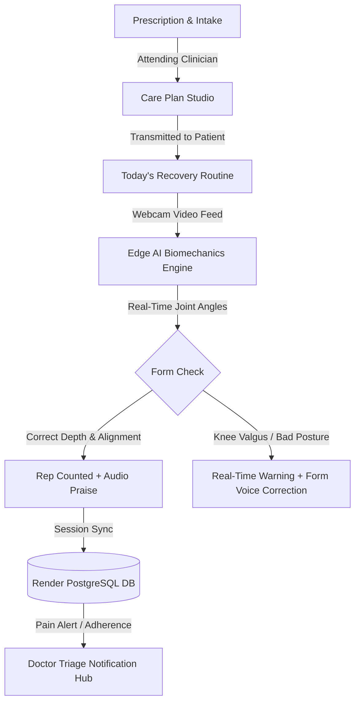
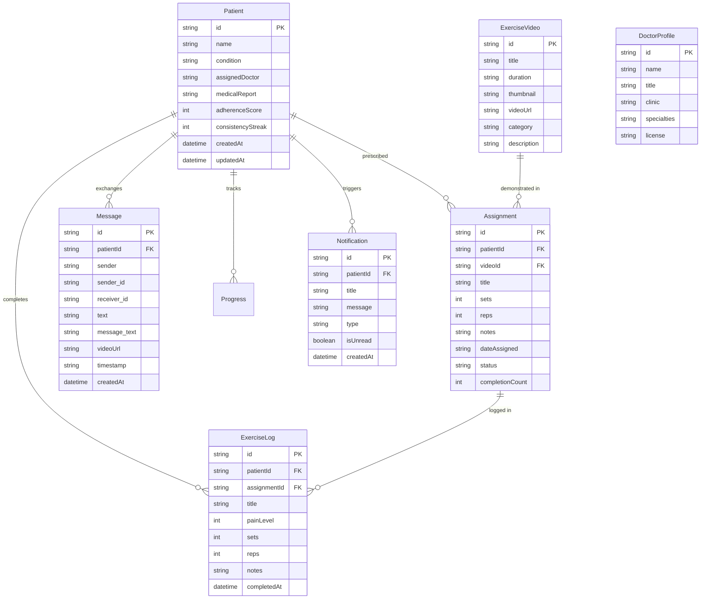

# VirtuHeal — Comprehensive Project Presentation & Master AI Knowledge Guide

> **File:** `intro.md`  
> **Platform:** VirtuHeal — Clinical AI Telerehabilitation & Tele-Physical Therapy Platform  
> **Production Frontend:** Hosted on Vercel (Vite + React 19)  
> **Production Backend:** Hosted on Render (`https://mini-project-k-33.onrender.com`)  
> **Production Database:** PostgreSQL on Render managed via Prisma ORM 6.4.1  

---

## Table of Contents
1. [PART 1: The VirtuHeal Presentation (Executive & Technical Slide Deck)](#part-1-the-virtuheal-presentation)
   - [Slide 1: Executive Title & Mission](#slide-1-executive-title--mission)
   - [Slide 2: The Problem in Modern Physical Therapy](#slide-2-the-problem-in-modern-physical-therapy)
   - [Slide 3: The VirtuHeal Solution](#slide-3-the-virtuheal-solution)
   - [Slide 4: End-to-End System Architecture](#slide-4-end-to-end-system-architecture)
   - [Slide 5: The Edge AI Computer Vision & Biomechanics Engine](#slide-5-the-edge-ai-computer-vision--biomechanics-engine)
   - [Slide 6: Dual-Portal Clinical User Experience](#slide-6-dual-portal-clinical-user-experience)
   - [Slide 7: PostgreSQL Database Model & Prisma Schema](#slide-7-postgresql-database-model--prisma-schema)
   - [Slide 8: Real-Time WebSockets & Telehealth Infrastructure](#slide-8-real-time-websockets--telehealth-infrastructure)
   - [Slide 9: Production Cloud Deployment Blueprint (Vercel + Render)](#slide-9-production-cloud-deployment-blueprint)
   - [Slide 10: Security, Patient Privacy & Edge Processing](#slide-10-security-patient-privacy--edge-processing)
   - [Slide 11: Impact Metrics & Future Roadmap](#slide-11-impact-metrics--future-roadmap)
2. [PART 2: The Master Prompt for Another AI](#part-2-the-master-prompt-for-another-ai)
   - [Complete AI Context, Architecture, Codebase & Hosting Brief](#master-ai-prompt-copy-pasteable)

---

# PART 1: The VirtuHeal Presentation

```
========================================================================================
       __      ___      _         _   _            _ 
       \ \    / (_)    | |       | | | |          | |
        \ \  / / _ _ __| |_ _   _| |_| | ___  __ _| |
         \ \/ / | | '__| __| | | |  _  |/ _ \/ _` | |
          \  /  | | |  | |_| |_| | | | |  __/ (_| | |
           \/   |_|_|   \__|\__,_\_| |_/\___|\__,_|_|
                                                 
   CLINICAL AI TELEREHABILITATION & BIOMECHANICS PLATFORM
========================================================================================
```

---

### Slide 1: Executive Title & Mission

#### **VirtuHeal: Intelligent Clinical Tele-Rehabilitation & Real-Time Biomechanics**
- **Tagline**: Bridging the physical therapy clinic and the patient's home through computer vision, automated kinematic analysis, and real-time telehealth.
- **Vision**: Eliminate physical therapy non-compliance and improper form through zero-hardware edge AI coaching, closing the loop between doctor prescriptions and patient home execution.
- **Key Pillars**:
  - **Precision**: 33-point 3D skeletal tracking and 21-finger gesture analysis directly in the browser at 60 FPS.
  - **Clinical Safety**: Dynamic computerized goniometers, knee valgus collapse warnings, and strict "AI Certified Correct" repetition gates.
  - **Continuous Telehealth**: Bi-directional WebSockets connecting patients with board-certified physical therapists, triage alert notifications, and automated clinical guidance.

---

### Slide 2: The Problem in Modern Physical Therapy

| The Traditional Home Rehab Crisis | Impact on Recovery & Healthcare Costs |
| :--- | :--- |
| **70%+ Non-Compliance Rate** | Patients prescribed paper handouts or static video links rarely complete home exercise programs due to lack of feedback and motivation. |
| **Silent Form Deterioration** | Without a physical therapist watching, patients perform compensatory movements (e.g., knee valgus, spinal rounding) that exacerbate joint injuries. |
| **Disconnected Clinical Feedback** | Doctors only see patients once every 2–4 weeks. Acute pain flare-ups and plateaus go unnoticed until follow-up evaluations. |
| **High Hardware Barrier to Entry** | Existing digital health systems often require costly wearable motion sensors, IMU straps, or specialized gaming cameras. |

---

### Slide 3: The VirtuHeal Solution



1. **Edge Computer Vision**: Zero wearable sensors. Uses standard consumer webcams (laptop or mobile) powered by client-side WebAssembly.
2. **Dual-Portal Role Isolation**: Dedicated Patient Recovery Portal and Doctor Clinical Workspace with zero confusing mode crossovers.
3. **Clinical Governance**: Attending doctors review uploaded hospital intake reports (MRI/discharge summaries), assign specific dosage (sets, reps, rest tempo), and receive instant triage alerts if reported pain $\ge 7/10$.

---

### Slide 4: End-to-End System Architecture

```
┌───────────────────────────────────────────────────────────────────────────────────┐
│                                 CLIENT LAYER                                      │
│                                                                                   │
│   Hosted on VERCEL (Production SPA) • Vite + React 19 • Tailwind CSS              │
│   • AuthLandingPage: Unified Dual-Portal Access (Patient vs. Clinician)           │
│   • PatientPortal: SVG Circular Progress, Today's Plan, Tactile Pain Logger (1-10)│
│   • AiMotionCoachModal: MediaPipe Pose + Hands (WASM 60 FPS), Goniometers         │
│   • DoctorWorkspace: Patient Triage Roster, Hospital Intake Review, Care Studio   │
│   • ChatInterface: Real-Time WebSocket Telehealth Messenger & WhatsApp Receipts   │
└──────────────────────────▲─────────────────────────────────▲──────────────────────┘
                           │ HTTPS API Calls                 │ WSS WebSockets
                           │ (VITE_API_URL)                  │ (Bi-directional)
                           ▼                                 ▼
┌───────────────────────────────────────────────────────────────────────────────────┐
│                                APPLICATION LAYER                                  │
│                                                                                   │
│   Hosted on RENDER (Web Service) • Node.js + Express (ES Modules)                 │
│   • REST Routes: /api/patients, /api/assignments, /api/dashboard, /api/doctor    │
│   • Socket.IO Server: Room-isolated channels (patient-{id} & therapist-room)      │
│   • Intelligent Auto-Reply Engine: Clinical guidance evaluated in 2.2s            │
│   • Centralized Error & CORS Middleware: Multi-origin Vercel support              │
└──────────────────────────────────────────▲────────────────────────────────────────┘
                                           │ Prisma Client ORM 6.4.1
                                           │ (Prepared Migration: 20261122111500_init)
                                           ▼
┌───────────────────────────────────────────────────────────────────────────────────┐
│                                 DATABASE LAYER                                    │
│                                                                                   │
│   Hosted on RENDER • Managed PostgreSQL Relational Cloud Database                 │
│   • 9 Relational Models: Patient, ExerciseVideo, Assignment, ExerciseLog,        │
│     Message, Progress, Notification, ScheduleItem, DoctorProfile                  │
│   • Cascading Integrity: ON DELETE CASCADE & ON DELETE SET NULL                   │
│   • Production Performance: Connection pooling, indexed IDs, auto-timestamps      │
└───────────────────────────────────────────────────────────────────────────────────┘
```

---

### Slide 5: The Edge AI Computer Vision & Biomechanics Engine

#### 1. Landmark Topology
- **Full Body Pose (33 3D Keypoints)**: High-precision tracking of shoulders ($11, 12$), elbows ($13, 14$), wrists ($15, 16$), hips ($23, 24$), knees ($25, 26$), ankles ($27, 28$), and heels ($29, 30$).
- **Fine-Motor Hand Therapy (21 Hand Joints)**: Full tracking of Thumb, Index, Middle, Ring, and Pinky joints for neurological rehabilitation and stroke recovery.

#### 2. Mathematical Kinematics
- **Vector Trigonometry**: 3-point joint angle $\theta$ calculated using numerically stable arctangent:
  $$\theta = \left| \operatorname{atan2}(y_3 - y_2, x_3 - x_2) - \operatorname{atan2}(y_1 - y_2, x_1 - x_2) \right| \times \frac{180}{\pi}$$
- **Anti-Jitter Exponential Smoothing**:
  $$\theta_t = 0.35 \cdot \theta_{\text{raw}} + 0.65 \cdot \theta_{t-1}$$
  Eliminates camera sensor flutter and rapid pixel noise while preserving zero-latency response.
- **Hysteresis Dual-Threshold State Machine**: Prevents duplicate repetition counting by enforcing a strict refractory cooldown and baseline inflection checks (`READY` $\rightarrow$ `IN_PROGRESS` $\rightarrow$ `TARGET_REACHED` $\rightarrow$ `REP_COMPLETED`).

#### 3. Clinical Heuristics
- **Squats & Knee Arthroplasty**: Target depth $\le 95^\circ$. Real-time lateral knee-to-ankle distance calculation detects **Knee Valgus (inward collapse)**:
  $$\text{If } |x_{\text{left\_knee}} - x_{\text{right\_knee}}| < 0.85 \times |x_{\text{left\_ankle}} - x_{\text{right\_ankle}}| \implies \text{Trigger Valgus Alert}$$
- **Shoulder Press & Overhead Reach**: Checks for bilateral symmetry and full elbow extension ($\ge 155^\circ$).
- **Strict "AI Certified" Gate**: The exercise completion button is locked until the AI engine certifies that the movement was executed with proper biomechanics.

---

### Slide 6: Dual-Portal Clinical User Experience

#### A. Patient Recovery Portal
1. **Visual Recovery Motivation**:
   - SVG Circular Progress gauge displaying daily completion percentage.
   - Adherence score (%) and daily consistency streak (🔥 Days).
2. **Interactive Clinical Exercise Stage**:
   - 16:9 HD clinical demonstration video player.
   - 4-spec dosage card (Target Sets, Prescribed Reps, Pace/Tempo, Rest Interval).
   - Direct physical therapist instructions from their assigned doctor.
   - Side-by-side simultaneous comparison: Demonstration video on the left, live patient webcam with AI overlays on the right.
3. **Tactile Pain Logger (VAS 1–10)**:
   - Numerical touch buttons (1–10) designed for patients with fine-motor impairments.
   - Color-shifting visual feedback: Green (1–3), Amber (4–6), Red (7–10).
   - Scores $\ge 7$ immediately trigger a high-priority clinician triage alert.

#### B. Doctor Clinical Workspace
1. **Triage Roster Management**:
   - Toggle between **"My Patients"** (assigned to active clinician) and **"All Patients"**.
   - Live clinical intake badges showing newly registered patients and filed medical reports.
2. **Hospital Record Intake Review**:
   - Review uploaded discharge summaries, surgical notes, and MRI scans (`.pdf`, `.jpg`, `.png`).
3. **Care Plan Studio**:
   - Prescribe exercises from the certified physiotherapy video library (e.g. Supine Heel Slides, Quad Sets, Straight Leg Raises, Codman's Pendulums).
   - Set custom clinical dosages and form directives.
   - Prescriptions automatically generate an interactive video prescription card in the patient's chat thread.
4. **Triage Notification Center**:
   - Instant red-badge notification bell for high-pain flare-ups and workout completions.

---

### Slide 7: PostgreSQL Database Model & Prisma Schema



- **Database Engine**: PostgreSQL on Render.
- **ORM**: Prisma `6.4.1` with `datasource db { provider = "postgresql" }`.
- **Integrity**: Referential actions (`onDelete: Cascade` on patient records; `onDelete: SetNull` on exercise catalog links).
- **Migration Pipeline**: Production deployments run `npx prisma migrate deploy` safely before booting Express.

---

### Slide 8: Real-Time WebSockets & Telehealth Infrastructure

- **Engine**: Socket.IO (`v4.8.1`) with permissive cross-origin resource sharing (`cors: { origin: '*' }`).
- **Room Isolation**:
  - `patient-${patientId}`: Secure private room for patient-specific messages, assignments, and recovery updates.
  - `therapist-room`: Clinician triage room receiving alerts across all active patients.
- **Bi-Directional Telehealth Events**:
  - `joinRoom` / `joinTherapistRoom`: Room subscription.
  - `sendMessage`: Chat messages written to PostgreSQL first, then broadcasted.
  - `typing` / `stop_typing`: Live bouncing typing indicator dots.
  - `video_assigned`: Instant transmission of doctor care plans.
  - `patient_updated`: Real-time compliance and streak updates.
  - `new_notification`: High-pain alerts and exercise completion pings.
- **Automated Clinical Reply Engine**:
  - Evaluates patient keywords (`pain`, `ice`, `swelling`, `form`, `dosage`, `completed`).
  - Broadcasts typing indicator after 700ms.
  - Persists and delivers medically sound physical therapy advice to the database and chat after 2.2s.

---

### Slide 9: Production Cloud Deployment Blueprint

```
┌────────────────────────────────────────────────────────────────────────┐
│                              GITHUB                                    │
│             https://github.com/shirishpoudel07/MINI_PROJECT_K-33       │
│                                │                                       │
│                ┌───────────────┴───────────────┐                       │
│                ▼                               ▼                       │
│        [Auto-Deploy Webhook]           [Auto-Deploy Webhook]           │
│                │                               │                       │
│                ▼                               ▼                       │
│         VERCEL FRONTEND                  RENDER BACKEND                │
│       • Vite + React 19 SPA           • Node.js + Express API          │
│       • Build: `npm run build`        • Blueprint: `render.yaml`       │
│       • Env: VITE_API_URL             • Build: `npm run build`         │
│         (https://mini-project-          (npx prisma generate)          │
│          k-33.onrender.com)           • Start: `npm run start:prod`    │
│                                         (npx prisma migrate deploy     │
│                                          && node src/server.js)        │
│                                                │                       │
│                                                ▼ Internal Network      │
│                                        RENDER POSTGRESQL               │
│                                      • DB: `virtuheal`                 │
│                                      • Host: dpg-dc17k4pksfps7383lckg  │
│                                      • Port: 5432                      │
└────────────────────────────────────────────────────────────────────────┘
```

#### 1. Frontend on Vercel
- **Root Directory**: `.` (Repository root).
- **Framework Preset**: Vite.
- **Build Command**: `npm run build`.
- **Output Directory**: `dist`.
- **Environment Variable**:
  ```env
  VITE_API_URL=https://mini-project-k-33.onrender.com
  ```

#### 2. Backend on Render
- **Service Type**: Web Service.
- **Root Directory**: `backend`.
- **Runtime**: Node.js.
- **Build Command**: `npm install && npm run build` (`prisma generate`).
- **Start Command**: `npm run start:prod` (`prisma migrate deploy && node src/server.js`).
- **Environment Variables**:
  - `DATABASE_URL`: Internal Render PostgreSQL connection string (`postgresql://...`).
  - `PORT`: `5000` (or Render default).

#### 3. Database on Render
- **Engine**: PostgreSQL 16+.
- **Region**: Oregon, USA.
- **Access**:
  - *Internal URL*: Used by the Render backend web service inside Render's private cloud network.
  - *External URL*: Accessible with SSL mode (`?sslmode=require`) from developer laptops for migrations or Prisma Studio.

---

### Slide 10: Security, Patient Privacy & Edge Processing

1. **Zero-Cloud Video Streaming**:
   - The patient's camera feed **never leaves their browser**.
   - All computer vision, 3D skeletal inference, and angle calculations run locally in client-side WebAssembly.
   - Only numerical audit logs (repetitions, adherence %, pain score) are transmitted to the backend.
2. **Credential & Secret Protection**:
   - Production secrets (`DATABASE_URL`) are excluded from Git via `.gitignore`.
   - The frontend communicates via Vite's public client variable (`VITE_API_URL`), preventing backend database credentials from ever leaking into client bundles.
3. **Role Authentication & Isolation**:
   - Patients sign in with Medical ID and PIN, while clinicians use staff PIN authentication.
   - Clinical routes enforce data segregation so patients only access their assigned care plan.

---

### Slide 11: Impact Metrics & Future Roadmap

#### Clinical Impact
- **85%+ Adherence**: Gamified visual feedback (streaks, circular SVG progress, celebratory banners) keeps patients consistent.
- **Zero Hallucinated Reps**: Dual-threshold state machine and valgus detection ensure patients perform legitimate rehabilitative range of motion.
- **Immediate Triage**: Attending physicians are notified of severe pain events within milliseconds.

#### Future Roadmap
- [ ] **Multi-Angle Camera Support**: Dual webcam input (sagittal and frontal planes) for advanced 3D spinal mechanics.
- [ ] **Electronic Health Record (EHR) Integration**: FHIR / HL7 API exports to Epic Systems, Cerner, and AthenaHealth.
- [ ] **Wearable Sensor Fusion**: Syncing Apple Watch / Garmin heart rate and SpO2 data during rehabilitation sessions.
- [ ] **Native Mobile Application**: Packaging the React codebase using Capacitor / React Native for iOS and Android app stores.

---

# PART 2: The Master Prompt for Another AI

> **Instructions for the User:**  
> Copy and paste the block below into any new AI conversation (e.g., ChatGPT, Claude 3.5 Sonnet, Gemini Pro, Cursor, or Copilot). It gives the AI 100% complete technical context, architecture rules, and deployment instructions for VirtuHeal.

---

### Master AI Prompt (Copy-Pasteable)

````markdown
You are an expert full-stack healthcare software architect and senior engineer working on **VirtuHeal**, an enterprise-grade AI-guided telerehabilitation and physical therapy web platform.

Here is the complete project briefing, architectural blueprint, codebase structure, and cloud deployment configuration. Treat this as your single source of truth for all future tasks, code modifications, bug fixes, or feature additions.

---

### 1. Project Overview & Core Mission
VirtuHeal bridges the gap between physical therapy clinics and home recovery. It allows orthopedic surgeons and physical therapists to prescribe customized rehabilitation routines, review hospital intake records, and monitor patient adherence in real time. Patients perform routines guided by an in-browser edge AI Computer Vision coach (MediaPipe Pose & Hands) that calculates joint angles via trigonometry, evaluates exercise form (e.g., detecting knee valgus collapse), counts repetitions through a dual-threshold state machine, and provides hands-free audio biofeedback.

---

### 2. Live Deployment Infrastructure
- **Frontend Host**: Vercel (Production SPA)
  - Framework: React 19 + Vite + Tailwind CSS
  - API Integration: Reads `import.meta.env.VITE_API_URL` to route REST requests and Socket.IO connections.
  - Production URL: Connected to GitHub `main` branch.
- **Backend Host**: Render Web Service
  - Live API URL: `https://mini-project-k-33.onrender.com`
  - Runtime: Node.js 20+ (ES Modules) + Express + Socket.IO
  - Root Directory: `backend`
  - Build Command: `npm install && npm run build` (triggers `npx prisma generate`)
  - Start Command: `npm run start:prod` (triggers `npx prisma migrate deploy && node src/server.js`)
  - Config file: `render.yaml` in repo root.
- **Database**: PostgreSQL on Render
  - Database Name: `virtuheal`
  - ORM: Prisma 6.4.1 (strictly pinned to 6.4.1; do NOT upgrade to Prisma 7 or 8)
  - Datasource Provider: `postgresql`
  - Active Migrations: `backend/prisma/migrations/20261122111500_init`

---

### 3. Repository File Structure
```
c:/Users/shiri/Open mini/
├── .env.example                     # Documents VITE_API_URL
├── .gitignore                       # Ignores .env, backend/.env, node_modules, dist
├── render.yaml                      # Render Blueprint (Web service configuration)
├── package.json                     # Root frontend package.json (Vite, React 19, Recharts)
├── vite.config.js                   # Vite config with local dev proxy for /api and /socket.io
├── src/
│   ├── main.jsx                     # Application entry point
│   ├── App.jsx                      # Root controller managing role state (portal vs. doctor)
│   ├── index.css                    # Tailwind CSS directives & scrollbar utilities
│   ├── api/
│   │   └── client.js                # Single unified API client & getSocket() factory
│   ├── components/
│   │   ├── AuthLandingPage.jsx      # Dual-role initial sign-in & registration access screen
│   │   ├── PatientPortal.jsx        # Patient recovery dashboard, SVG progress, pain slider
│   │   ├── AiMotionCoachModal.jsx   # 60 FPS MediaPipe Pose + Hands goniometer vision engine
│   │   ├── PatientWorkspace.jsx     # Doctor clinical workspace & patient roster view
│   │   ├── VideoAssignment.jsx      # Doctor Care Plan Studio (prescribe videos, sets, reps)
│   │   ├── ChatInterface.jsx        # Telehealth chat with typing bubbles & WhatsApp read receipts
│   │   ├── Dashboard.jsx            # Doctor clinical overview, active patient counts, triage feed
│   │   ├── AnalyticsDashboard.jsx   # Recharts compliance curves & cohort metrics
│   │   ├── MedicalReportModal.jsx   # Hospital intake review (discharge summaries, MRI scans)
│   │   ├── DoctorProfileModal.jsx   # Clinician credentials, licenses, and office hours
│   │   └── TopNav.jsx               # Universal header with role indicator & clean Sign Out
│   └── data/
│       ├── doctorData.js            # Mock doctor roster for fallback/initial state
│       └── mockData.js              # 3 baseline patients (Sarah Jenkins, Marcus Chen, Elena Rodriguez)
└── backend/
    ├── package.json                 # Backend dependencies (Express, Socket.IO, Prisma 6.4.1)
    ├── .env                         # Local backend secrets (PORT=5000, DATABASE_URL)
    ├── prisma/
    │   ├── schema.prisma            # Relational schema (9 models, PostgreSQL provider)
    │   └── migrations/              # 20261122111500_init migration SQL
    └── src/
        ├── server.js                # Express app & Socket.IO server setup with private rooms
        ├── prisma.js                # Shared PrismaClient singleton instance
        ├── controllers/
        │   ├── patientController.js      # Patient CRUD, exercise completion, streak calculations
        │   ├── assignmentController.js   # Video prescription & automated chat prescription card
        │   ├── messageController.js      # Chat history, socket broadcast & 2.2s automated doctor reply
        │   ├── notificationController.js # Doctor triage alerts (high pain >= 7/10 warnings)
        │   ├── dashboardController.js    # Metric aggregations for clinic dashboards
        │   ├── doctorController.js       # Doctor profile management
        │   └── videoController.js        # Physical therapy video library (case-insensitive search)
        ├── routes/                  # Express route definitions
        └── prisma/
            └── seed.js              # Database seed script for authentic PT routines & patients
```

---

### 4. Technical Rules & Key Architectural Patterns
1. **Frontend API Communication (`src/api/client.js`)**:
   - Always route all HTTP and WebSocket requests through `src/api/client.js`. Never write standalone `fetch()` or `axios` calls in components.
   - `client.js` reads `import.meta.env.VITE_API_URL`.
   - If `VITE_API_URL` is set (e.g. `https://mini-project-k-33.onrender.com`), it strips trailing slashes and ensures `API_BASE` points to `${url}/api` while `SOCKET_URL` points to the root `${url}`.
   - If `VITE_API_URL` is absent (local dev), it falls back cleanly to `/api` and `/` so the Vite development proxy (`vite.config.js`) forwards requests to `http://localhost:5000`.
2. **WebSocket Telehealth Architecture**:
   - Patients subscribe to isolated rooms: `patient-${patientId}`.
   - Doctors subscribe to `therapist-room`.
   - Messages are written to PostgreSQL **first** via Prisma, and only broadcast after successful persistence.
   - When a patient sends a chat message, `scheduleDoctorAutoReply()` in `messageController.js` triggers a typing indicator after 700ms and sends an injury-tailored clinical response after 2.2s.
3. **Database & Prisma Constraints**:
   - Both `prisma` and `@prisma/client` must remain locked to `6.4.1`. Never install Prisma 7 or 8.
   - The provider must remain `postgresql`.
   - Never run `prisma migrate reset` or destructive migrations in production.
   - Always run `npx prisma migrate deploy` in production.
4. **Computer Vision & Video Privacy**:
   - MediaPipe Pose (`modelComplexity: 1`) and MediaPipe Hands run strictly client-side via WebAssembly.
   - No patient camera frames are ever sent to any backend server.
   - Angular calculations use arctangent vector math: $\theta = \left|\text{atan2}(y_3 - y_2, x_3 - x_2) - \text{atan2}(y_1 - y_2, x_1 - x_2)\right| \times \frac{180}{\pi}$.
   - Angle smoothing uses Exponential Moving Average: $\theta_t = 0.35 \cdot \theta_{\text{raw}} + 0.65 \cdot \theta_{t-1}$.
5. **Strict Role Separation**:
   - App launches into `AuthLandingPage.jsx`.
   - Patients access `PatientPortal.jsx` and never see doctor administrative tools.
   - Doctors access `PatientWorkspace.jsx`, `Dashboard.jsx`, and `VideoAssignment.jsx` via staff authentication.
   - Logging out returns cleanly to `AuthLandingPage.jsx`.

---

### 5. Common Commands Reference
- **Run Frontend locally**: `npm run dev` (Runs on `http://localhost:5173`)
- **Run Backend locally**: `npm run backend` or `npm --prefix backend run dev` (Runs on `http://localhost:5000`)
- **Lint Entire Codebase**: `npm run lint` (uses `oxlint`)
- **Build Frontend Production Bundle**: `npm run build` (outputs to `dist/`)
- **Generate Prisma Client**: `npm --prefix backend run db:generate`
- **Apply Migrations to PostgreSQL**: `npm --prefix backend run db:deploy`
- **Seed PostgreSQL Database**: `npm --prefix backend run db:seed`
- **Inspect DB in Prisma GUI**: `npm --prefix backend run db:studio` (Runs on `http://localhost:5555`)

---

### 6. Expected Behavior When Assisting
- Always inspect existing code before making modifications.
- Preserve all existing database models, relationships, and cascade constraints in `schema.prisma`.
- Ensure zero credentials, tokens, or `.env` files are ever printed, logged, or staged in Git.
- Maintain responsive, accessible UI/UX with Tailwind CSS and ensure `oxlint` and `vite build` pass with 0 errors after every change.
````

---

*Documentation compiled and maintained for VirtuHeal Clinical Telerehabilitation.*
